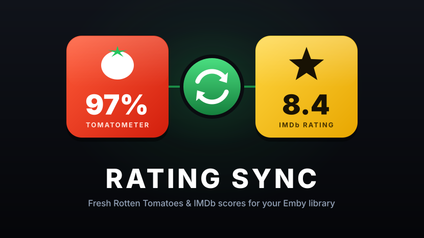
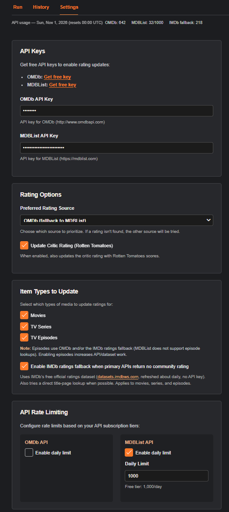
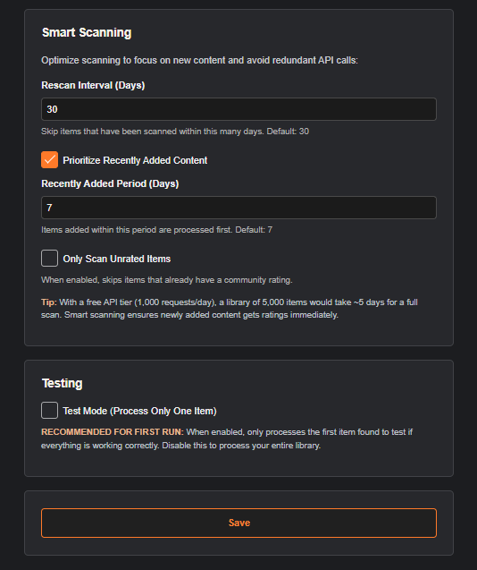
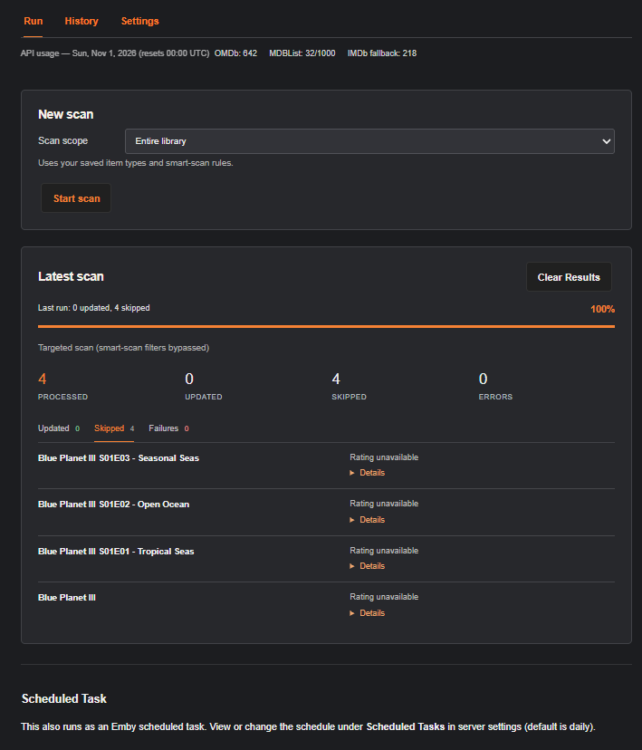
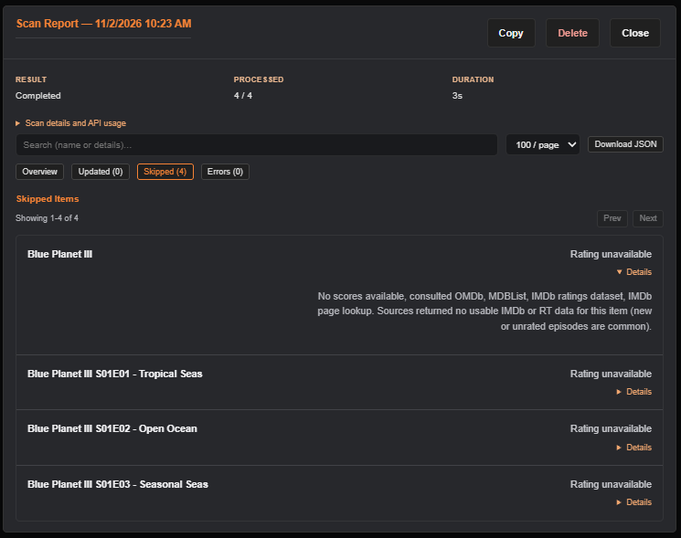
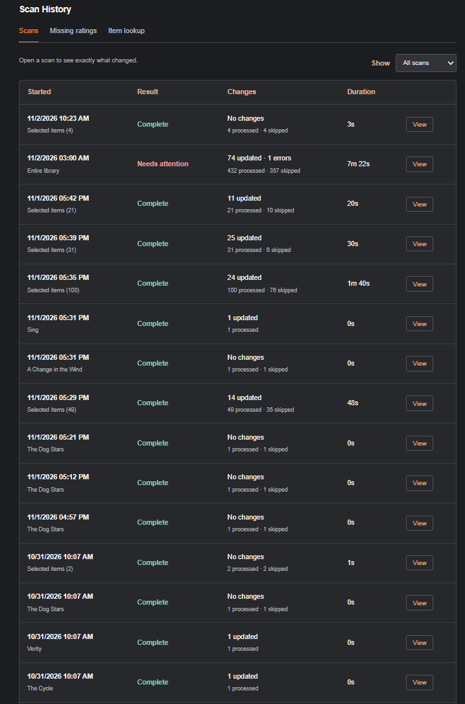
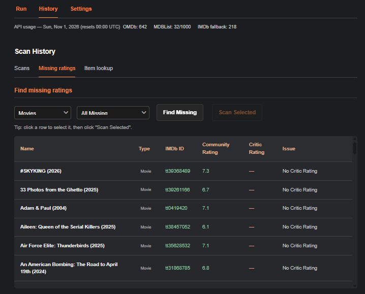

<p align="center">
  
</p>

<h1 align="center">Rating Sync</h1>

<p align="center">
  Emby plugin that syncs IMDb community ratings and Rotten Tomatoes critic ratings into your library metadata.
</p>

<p align="center">
  <a href="#features">Features</a> ·
  <a href="#install">Install</a> ·
  <a href="#quick-start">Quick start</a> ·
  <a href="#screenshots">Screenshots</a> ·
  <a href="https://github.com/pejamas/rating-sync/releases">Download</a>
</p>

<p align="center">
  <a href="https://github.com/pejamas/rating-sync/actions/workflows/ci.yml"></a>
  <a href="https://github.com/pejamas/rating-sync/releases"></a>
  <a href="https://github.com/pejamas/rating-sync/releases"></a>
  <a href="LICENSE"></a>
</p>

## Features

- Update Movies, Series, and optionally Episodes
- Prefer OMDb, MDBList, or both, with an optional IMDb official-dataset fallback
- Pace each provider independently and enforce configurable daily API limits
- Smart scanning prioritizes recent additions and avoids unnecessary repeat requests
- Optional tiered rescanning checks newly released titles more often while their ratings settle
- Run full-library or precisely targeted movie, series, season, or episode scans
- Follow live results with stable ordering, expandable explanations, and before/after rating changes
- Filter scan history, inspect detailed reports, copy results, or download report JSON
- Find missing community or critic ratings and rescan an item directly
- Retry provider failures sooner without treating them as unchanged ratings
- Available from the Emby dashboard sidebar under Server

## What's new in 1.2.0

- **Tiered rescanning:** newly released titles can be rescanned on a shorter interval while their ratings are still settling, without spending API quota on older items. See [Tiered rescanning](#tiered-rescanning).
- New logo and a sharper plugin thumbnail.

See [CHANGELOG.md](CHANGELOG.md) for earlier releases.

## Tiered rescanning

Ratings move a lot in the first weeks after release, then settle. With tiered rescanning enabled (Settings > Smart Scanning), each item gets one of two intervals:

| Item | Rescan interval |
| --- | --- |
| Released within **Recent Release Age** (default 30 days) | **Recent Item Rescan Interval** (default 3 days) |
| Everything else | **Rescan Interval** (default 30 days) |

- "Released" uses the item's premiere date. Items without one, or with a future date, use the standard interval.
- **Max Rescans Before Graduating** (optional, 0 = no cap) moves an item to the standard interval after that many recent-tier rescans, even if it is still recent.
- It pairs with **Prioritize Recently Added Content**: that setting controls scan *order* by date added; tiered rescanning controls *how often* by release date.
- Off by default; existing settings and history are unaffected.

## Install

1. Download `RatingSync.dll` from the [latest release](https://github.com/pejamas/rating-sync/releases/latest).
2. Copy it into your Emby plugins folder (often `...\Emby-Server\programdata\plugins\`).
3. Restart Emby Server.
4. Open Dashboard > Plugins > Rating Sync, or use Rating Sync in the sidebar.

## Quick start

1. Add an OMDb and/or MDBList API key, or enable IMDb ratings fallback on its own.
2. Choose preferred source and which item types to update.
3. Optionally enable IMDb ratings fallback when primary APIs return no community rating.
4. Open the Run tab and start a refresh (full library or a targeted series / season / episode).

## Rating sources

| Source | What it provides |
| --- | --- |
| OMDb | IMDb community ratings (and related metadata lookups) |
| MDBList | Ratings including Rotten Tomatoes when available |
| IMDb fallback | Official IMDb ratings datasets when APIs have no score |

Episodes use OMDb and/or the IMDb fallback (MDBList does not support episode lookups).

## Screenshots

### Settings

API keys, sources, item types, and rate limits.



### Smart scanning

Control how often items are rescanned and what to prioritize.



### Run

Choose the scan scope, start a full or targeted refresh, and follow results as they complete.



### Scan report

Search and filter updates, skips, and errors; expand explanations or download the full report as JSON.



### History

Filter previous scans by outcome and open any run for its detailed report.



### Missing ratings

Find items missing community or critic ratings, then send a selected item directly to a targeted scan.



PNG files live in [`docs/screenshots/`](docs/screenshots/).

## Build

```powershell
dotnet build -c Release
```

Output: `bin\Release\RatingSync.dll`

### Local Emby assemblies (optional)

If Emby is installed locally, build against its `System` folder:

```powershell
dotnet build -c Release -p:EmbyPath="C:\Program Files\Emby-Server\System"
```

## Releases

Pushing a tag such as `v1.2.3` builds Release, creates a GitHub Release, and uploads `RatingSync.dll` plus a zip.

See [RELEASING.md](RELEASING.md).

## Versioning

[Semantic Versioning](https://semver.org/): `MAJOR.MINOR.PATCH`

- `PATCH`: bug fixes and small changes
- `MINOR`: backwards-compatible features
- `MAJOR`: breaking behavior, config, or API changes
